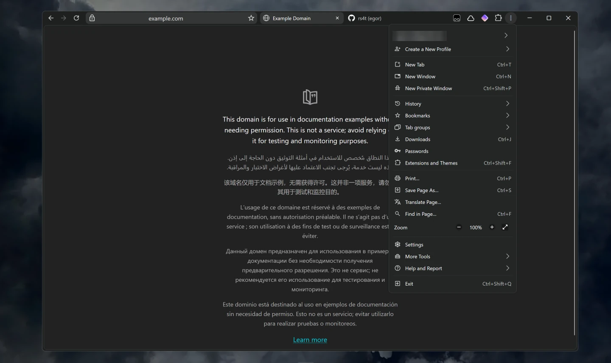

# Argon

### Formerly HeliumFox

A calm, clean Firefox theme. It starts from the [Helium](https://github.com/imputnet/helium) browser's look, measured almost pixel for pixel, and adds my own touches from [Latin Accent Plus](https://github.com/rs4t/latin-accent-plus) and [Zen-Nebula](https://github.com/JustAdumbPrsn/Zen-Nebula). Just CSS and a settings file.

Named after argon, the noble gas: its name is Greek for *idle*, and it glows blue-violet.

TODO list:
- Customize the right click menu
- Customize the hamburger menu more

Known Bugs:
- The "customize toolbar" thingy is bugged

**[Features](#features)** · **[Install](#install)** · **[Firefox Compact](#recommended-firefox-compact)** · **[Customize](#customize)** · **[Notes](#notes)** · **[Credits](#credits)**

<p align="center">
  
</p>

> [!TIP]
> **Use it with [Firefox Compact](#recommended-firefox-compact).** It adds Helium's layout picker and frameless mode, and Argon is designed around it. It's strongly recommended for the best experience.

## Features

| | Feature | What it does |
| --- | --- | --- |
| Helium | **Layout** | One row with the nav buttons, a wide address bar, `+`, extensions and the menu. Tabs show in a second row only with 2+ tabs |
| Helium | **Sizes** | 28px bar and buttons, 3px spacing, 197px tabs with 8px corners, page inset with rounded corners |
| Helium | **Colors** | Helium's dark and light palette, following your Windows setting |
| Helium | **Icons** | Chromium's own icons on the toolbar and in the menu, with Helium's round hover |
| Helium | **Address bar** | Centered URL, a lock on the left, the star on the right, a compact results list |
| Helium | **Loading bar** | A thin glowing line along the bottom of the address bar while a page loads |
| Helium | **Popups** | Menus, panels, prompts, the notification bar, the find bar and tooltips in Helium's style |
| Helium | **Scrollbars** | Thin overlay scrollbars that only show while scrolling |
| Argon | **Accent color** | Your Windows accent (it can follow your wallpaper), brightened so it stays readable |
| Argon | **Bookmarks bar** | Hidden until you hover the toolbar (*Only Show on New Tab* mode) |
| Argon | **Extensions panel** | A compact grid of icons, 4 per row. Right-click an icon for its menu |
| Argon | **Fullscreen pill** | A small rounded warning instead of Firefox's big banner |
| Argon | **Animations** | Short, no bounce: tab switches, address-bar results, the tab ✕. Off with Windows' *Animation effects* |
| Argon | **No purple** | Firefox 159's built-in violet accent replaced with yours |

## Install

**Windows:** paste this into PowerShell and press Enter.

```powershell
irm https://raw.githubusercontent.com/rs4t/argon-firefox/main/install.ps1 | iex
```

It finds your Firefox profile, installs the theme as `argon.css` and `argon-content.css`, and keeps other imports like Firefox Compact's. It also replaces Latin Accent Plus or HeliumFox if you had them, backing up the old files. If Firefox is closed, it arranges the toolbar like Helium. Read what it does in [install.ps1](install.ps1).

<details>
<summary><b>Manual install</b> (or Mac/Linux)</summary>

**1. Copy the files.** Open `about:profiles`, find the **Root Directory** of your active profile and open it.
- Copy everything from [`chrome/`](chrome) into a `chrome` folder there. Create the folder if it doesn't exist.
- Copy [`user.js`](user.js) next to it, directly in the profile folder.

If you already have a `userChrome.css` or `userContent.css`, add `@import "argon.css";` or `@import "argon-content.css";` to it instead of replacing it.

**2. Restart Firefox** completely (close it, then reopen it).

**3. Arrange the toolbar like Helium.** Right-click the toolbar and choose **Customize Toolbar…**:
- Drag the **New Tab** (`+`) button from the tab row to just after the address bar.
- Remove the flexible spaces and the sidebar button.
- Pinned extensions go after the `+`.

</details>

**Optional:** for the bookmarks bar hover, right-click the toolbar, then **Bookmarks Toolbar**, then **Only Show on New Tab**.

## Recommended: Firefox Compact

[**Firefox Compact**](https://github.com/rs4t/firefox-compact) ([add to Firefox](https://addons.mozilla.org/firefox/addon/compact-mode/)) is a small add-on that gives Argon Helium's layout settings in a popup:

| Layout | What it does |
| --- | --- |
| **Dynamic** (default) | Toolbar on top. The tab row only appears with 2 or more tabs |
| **Classic** | Tab row on top, toolbar below |
| **Compact** | Everything in one row: address bar, tabs, `+`, extensions, menu |
| **Vertical** | Firefox's own vertical tabs (Settings → General → Browser layout), styled like Helium |

It also adds Helium's **Frameless mode**: the toolbars hide until you hover the top of the window, and the page goes edge to edge. **Always show the top bar** hides only the tabs. Argon is designed with it in mind, so it's strongly recommended.

## Customize

At the top of `argon.css`:

| Variable | What it does |
| --- | --- |
| `--h-pad` | Spacing around the toolbar and page (Helium: `3px`) |
| `--h-bar` | Height of the address bar, buttons and tabs (Helium: `28px`) |
| `--h-radius` | Corner roundness (Helium: `8px`) |
| `--h-tab-slot` | Tab width (Helium: `201px`) |
| `--h-url-font` / `--h-tab-font` | Text size in the address bar and on tabs |

For a fixed accent color instead of your Windows one, search for `--h-accent-raw: AccentColor;` and replace `AccentColor` with a color like `#7296ff`. Every section is labeled, so you can delete any feature you don't want.

## Notes

- Dark mode is measured from Helium pixel by pixel. Light mode uses Helium's light colors from its source, but has been tested less.
- Made for **Firefox 159** on **Windows 11**. Firefox updates sometimes rename things. If something breaks, please [open an issue](../../issues).
- The window-button spacing assumes Windows. On Mac or Linux, adjust `--h-caption-width`.
- Argon is an unofficial fan theme and isn't affiliated with Helium or imput.

## Credits

- [**Helium**](https://github.com/imputnet/helium) by imput: the main inspiration. Its layout, sizes, colors, progress bar, info bar and find bar values come from its source.
- [**Latin Accent Plus**](https://github.com/rs4t/latin-accent-plus) (my other theme): the accent color, bookmarks reveal, fullscreen pill and animations. It's based on [**Latin Accent**](https://github.com/Acercandr0/Latin-Accent) by Acercandr0.
- [**Zen-Nebula**](https://github.com/JustAdumbPrsn/Zen-Nebula) by JustADumbPrsn: the original tab-switch animation (toned down here).
- [**Chromium**](https://chromium.googlesource.com/chromium/src) (BSD license): the toolbar and menu icons, from its "Chrome Refresh" icon set.

## License

[GPL-3.0](LICENSE), the same license as Helium.
